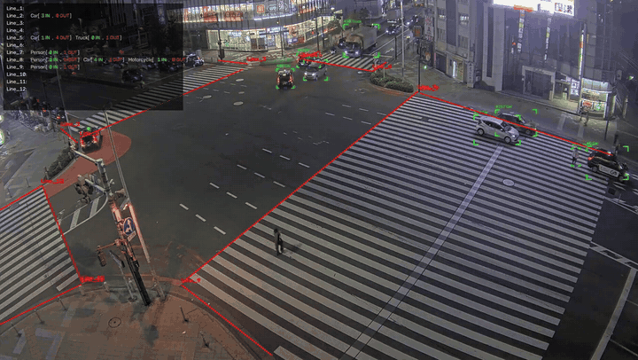
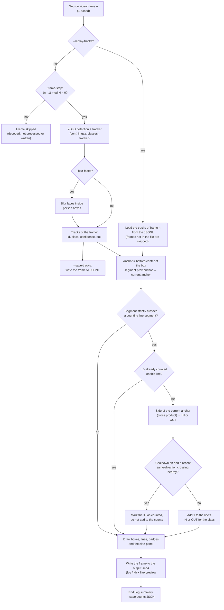

# Directional Line Crossing Counter

Count people and vehicles crossing user-drawn lines in a video, separated by direction (IN / OUT).

You draw one or more counting lines on the first frame of a video. Each frame is
then processed with an Ultralytics YOLO detector and the BoT-SORT tracker. A
track is counted when the bottom-center point of its box crosses a line segment.
The annotated video is written to disk frame by frame. A Tkinter launcher and a
command-line interface are both included.



## Features

- Interactive line drawing on the first frame in a resizable OpenCV window; clicks are mapped back to the original resolution.
- Any number of counting lines; lines can be saved to and loaded from JSON.
- Tracks the COCO classes person, car, motorcycle, bus and truck (configurable).
- Strict segment-to-segment crossing test: objects passing beside the end of a line are not counted.
- Direction (IN / OUT) from the sign of a 2D cross product; each track ID counted at most once per line.
- Per-line, per-class IN/OUT counts in a side panel next to the video (nothing hides the scene), with a count badge and a distinct color per line; `--layout overlay` keeps the old on-frame HUD.
- Optional track export (`--save-tracks`) and re-rendering from it (`--replay-tracks`) without running the detector again.
- Frames are written as they are processed, so a run stopped early still leaves a playable video.
- Optional, best-effort face blurring inside person boxes.
- Tkinter launcher (3-step flow) or headless CLI (`--lines` + `--no-display`).

## How it works



- **Anchor and crossing:** the anchor is the bottom-center of the box, `((x1 + x2) // 2, y2)`. The trajectory segment from the previous to the current anchor of the same ID must intersect the drawn segment (counter-clockwise orientation test). With `--frame-step N` the previous anchor is the one of the previous *processed* frame.
- **Direction:** IN when the anchor moves from the negative to the positive side of the directed line `P1 -> P2` (2D cross product), OUT when it moves from the positive to the negative side. On screen (y pointing down) the positive side is the right-hand side when you walk from `P1` to `P2`; for a horizontal line clicked left to right, moving down is IN. The click order of a line therefore defines which way is IN.
- **Deduplication:** each line remembers the track IDs it has already counted. The optional `--max-track-gap SECONDS` skips the crossing test for a track that comes back with the same ID after a longer absence. The optional cooldown (`--cooldown-frames`, `--cooldown-px`) also drops a crossing in the same direction close in time and space to a previous one on the same line; the ID is still marked as counted.

See [docs/how-it-works.md](docs/how-it-works.md) for the formulas, edge cases and tuning tips.

## Installation

Requires Python 3.9+ and a desktop session for the OpenCV/Tkinter windows.

Linux / macOS:

```bash
git clone https://github.com/karemdm/directional-line-crossing-counter.git
cd directional-line-crossing-counter
python3 -m venv .venv
source .venv/bin/activate
pip install -r requirements.txt
pip install -e .        # installs the `line-counter` command
```

Windows (PowerShell):

```powershell
git clone https://github.com/karemdm/directional-line-crossing-counter.git
cd directional-line-crossing-counter
python -m venv .venv
.venv\Scripts\Activate.ps1
pip install -r requirements.txt
pip install -e .
```

On Debian/Ubuntu, Tkinter and OpenCV GUI support may need system packages:
`sudo apt install python3-tk libgl1 libglib2.0-0`.

**GPU:** Ultralytics runs on CPU, but processing with the default `--imgsz 2048`
is slow without a GPU. For an NVIDIA GPU, install a CUDA build of PyTorch first
following the instructions on pytorch.org, then install the requirements.

Place the model weights in `weights/` (see [weights/README.md](weights/README.md)).

## Results

Example outputs produced by this project (re-encoded to H.264, no audio):

| File | Content |
|---|---|
| [`results/shinjuku_line_count.mp4`](results/shinjuku_line_count.mp4) | Busy intersection with several counting lines; per-line IN/OUT counts for people and vehicles in the on-frame HUD (the older `--layout overlay` style, 1280x720). |
| [`results/shinjuku_90s_counted.mp4`](results/shinjuku_90s_counted.mp4) | Shinjuku crossing live webcam, 90 s, 12 lines. |
| [`results/shinjuku_3min_counted.mp4`](results/shinjuku_3min_counted.mp4) | Same webcam, 3 min, 12 lines. |
| [`results/abbey_road_3min_counted.mp4`](results/abbey_road_3min_counted.mp4) | Abbey Road crossing live webcam, 3 min, 4 lines. |

For the three live-webcam runs the inputs are in [`samples/`](samples/README.md) and the repository also keeps the tracks (`*_tracks.jsonl`) and the final per-line counts (`*_counts.json`), with the exact command and a per-line table in [results/README.md](results/README.md). Counts depend on detection and tracking quality; people far from the camera are small and are easily missed.

Source footage and attribution: see [results/README.md](results/README.md) and [samples/README.md](samples/README.md).

## Try it

Re-render a result from its saved tracks (no detector, no GPU, same counts):

```bash
line-counter --input samples/abbey_road_3min.mp4 --lines samples/abbey_road_lines.json --no-display \
    --replay-tracks results/abbey_road_3min_tracks.jsonl --output outputs/abbey_road_replay.mp4 \
    --save-counts outputs/abbey_road_counts.json
```

Or run the detector yourself on a sample (slow without a GPU):

```bash
line-counter --input samples/abbey_road_3min.mp4 --lines samples/abbey_road_lines.json --no-display \
    --imgsz 1920 --conf 0.15 --tracker configs/botsort_reid_static.yaml --frame-step 3 \
    --output outputs/abbey_road_3min_counted.mp4
```

## Usage

GUI launcher (also opens when no `--input` is given):

```bash
line-counter            # or: python -m line_counter --gui
```

1. **Select Input Video** (`.mp4`, `.avi`, `.mov`, `.mkv`).
2. **Draw Lines on Frame**: left-click two points per line; press **U** or **Backspace** to undo the last point or line; ENTER or ESC to finish. The window can be resized.
3. **Process and Save Video**: choose an output folder. Processing runs in a background thread so the window stays responsive; there is no live preview in the launcher.

CLI:

```bash
# Draw lines interactively, save them, then process
line-counter --input video.mp4 --save-lines lines.json

# Reuse saved lines, no preview window (stop with Ctrl+C)
line-counter --input video.mp4 --lines lines.json --no-display --output outputs/video_proc.mp4

# Stricter detection, smaller inference size, people only, with face blurring
line-counter --input video.mp4 --lines lines.json --conf 0.25 --imgsz 1280 --classes 0 --blur-faces
```

Lines file format (pixel coordinates in the original video resolution):

```json
[
  {"name": "Line_1", "points": [[120, 400], [860, 410]]}
]
```

## Small or distant people

On wide shots (for example a 1080p street camera filmed from high up) people are only a few
pixels tall, and the default settings lose many of them. To keep more crossings:

```bash
line-counter --input video.mp4 --lines lines.json --no-display \
    --imgsz 1920 --conf 0.15 --tracker configs/botsort_reid.yaml --frame-step 2
```

- **Larger input size first:** on a crowded 1080p crossing, raising `--imgsz` from 1280 to 1920 found
  almost twice as many people with the same medium model, more than switching to an extra-large model at
  the same size did. Try `--imgsz` before `--model`.
- **Larger model:** `--model yolo11x.pt` or `--model yolo26x.pt` (downloaded automatically by Ultralytics). Larger models find small people more reliably than the medium one.
- **Larger input size:** `--imgsz 1920` to `2560` for 1080p wide shots, so small people are not shrunk away before detection.
- **Lower confidence:** `--conf` around `0.1` to `0.2` keeps weak detections of small people without flooding the tracker with false ones.
- **Longer-memory tracker:** `--tracker configs/botsort_reid.yaml` keeps lost tracks for 90 processed frames (about 3 s at 30 fps with `--frame-step 1`, about 9 s with `--frame-step 3`, because the tracker only sees the processed frames), uses lower thresholds for weak detections and re-identifies people by appearance. `configs/bytetrack_long.yaml` is a lighter alternative without ReID.
- **Fixed camera:** `configs/botsort_reid_static.yaml` is the same tracker without camera-motion compensation. On a camera that does not move this skips the costly global-motion step at no loss, so it is the better choice for street webcams; the results in `results/` use it.
- **Fewer frames:** `--frame-step 2` (or 3) processes every Nth frame and writes the output at fps/N, which keeps long videos feasible at a large `--imgsz`. Keep it low for fast movers: people must not travel too far between processed frames.
- **Duplicate crossings (optional):** if ID switches double-count the same person at a line, try `--cooldown-frames 15 --cooldown-px 40`. It is off by default because it can also hide two real people crossing side by side in a crowd.

The trade-off is speed: a larger model, a larger `--imgsz` and ReID each make processing
noticeably slower, and a lower `--conf` adds false detections. Start with one change at a
time and compare the counts on a short clip you have verified by eye.

## Parameters

| Name | Default | Description |
|---|---|---|
| `--input`, `-i` | none | Input video. Without it, the GUI opens. |
| `--output`, `-o` | `<input folder>/<name>_proc.mp4` | Output video path. |
| `--lines` | none | JSON file with lines; skips interactive drawing. |
| `--save-lines` | none | Export interactively drawn lines to JSON. |
| `--model` | `weights/yolov8m.pt` | Detector weights. Official Ultralytics names auto-download. |
| `--conf` | `0.01` | Detection confidence threshold (see note below). |
| `--imgsz` | `2048` | Inference image size. |
| `--classes` | `0 2 3 5 7` | COCO class IDs (person, car, motorcycle, bus, truck). |
| `--tracker` | `botsort.yaml` | Ultralytics tracker config (`bytetrack.yaml` also works; ready-made `configs/botsort_reid.yaml`, `configs/botsort_reid_static.yaml` (fixed camera) and `configs/bytetrack_long.yaml` for small or distant people). |
| `--frame-step` | `1` | Process every Nth frame; the output is written at fps/N so it plays at the original speed. |
| `--cooldown-frames` | `0` (off) | Skip a crossing in the same direction within this many source frames and `--cooldown-px` of a previous one on the same line (absorbs ID switches). |
| `--cooldown-px` | `40` | Radius in pixels used with `--cooldown-frames`. |
| `--max-track-gap` | `0` (off) | Seconds. If a track reappears with the same ID after a longer absence, no crossing is tested for that step (its old position is too stale). |
| `--layout` | `side` | `side` adds a dark panel with the counts to the right of the video (the output is wider); `overlay` draws the counts over the video. |
| `--save-tracks` | none | Write the tracks of every processed frame (id, class, confidence, box) to a JSON Lines file. |
| `--replay-tracks` | none | Skip detection and tracking and re-render from a file written by `--save-tracks` (frame step is taken from the file; face blur is not applied). |
| `--save-counts` | none | Write the final per-line, per-class IN/OUT counts to a JSON file when processing ends (also with `--replay-tracks`). |
| `--blur-faces` | off | Blur faces detected inside person boxes. |
| `--blur-padding` | `0.15` | Margin added around each face box, as a fraction of its size (clipped to the person box). `0` = tight box. |
| `--face-model` | `weights/face_yolov8m.pt` | Face detector weights for `--blur-faces`. |
| `--no-display` | off | Disable the live preview (requires `--lines`). |
| `--gui` | off | Open the Tkinter launcher. |
| `--verbose`, `-v` | off | Debug logging. |

Fixed internal values (in `ProcessingConfig`): face detector confidence `0.3`,
blur kernel `51x51`, blur sigma `30`.

> **Note on `--conf`:** the default `0.01` is kept from the original prototype.
> It is very permissive: it keeps weak detections (fewer lost tracks) but also
> produces false positives. Values in the range 0.1-0.25 are a more usual
> starting point.

## Output

- `<name>_proc.mp4` (MP4V codec, frame rate = input fps divided by `--frame-step`, so it plays at the original speed; with the default `--layout side` the frame is the original plus a panel on the right) with:
  - corner-style boxes labelled `#<track id> <class>` and the bottom-center anchor point,
  - the counting lines, each in its own color, with a small semi-transparent badge near the line showing its name and totals, e.g. `Line_4  12 in / 8 out`,
  - a side panel titled "Line counts" with one compact block per line (color swatch, name, then per-class counts such as `Person 12 in / 8 out   Car 3 in / 1 out`; only classes with a crossing are listed, otherwise `no crossings yet`). The font shrinks as needed so many lines fit, and if they still do not fit, a dim `+N more lines` row is shown; the panel ends with the total in/out over all classes. Class names are shown exactly as the model names them. With `--layout overlay` the counts are drawn over the video instead.
- Log messages for every counted crossing and a final per-line, per-class summary.
- Optionally, a lines file (`--save-lines`), a tracks file (`--save-tracks`) and a counts file (`--save-counts`): JSON with the input name, `mode` (`detect` or `replay`), the main settings, the lines and the final counts as `{line: {class: {"IN": n, "OUT": n}}}`.

## Project structure

```
directional-line-crossing-counter/
  README.md
  requirements.txt
  pyproject.toml
  configs/botsort_reid.yaml    # BoT-SORT + ReID, long buffer, for small people
  configs/botsort_reid_static.yaml  # same, without camera-motion compensation (fixed cameras)
  configs/bytetrack_long.yaml  # ByteTrack with a long buffer
  docs/how-it-works.md
  docs/assets/demo.gif
  results/README.md  # example outputs: videos, tracks, counts, commands and source notes
  results/*.mp4, *_tracks.jsonl, *_counts.json
  samples/README.md  # input clips and the lines files that go with them
  samples/*.mp4, *_lines.json
  weights/README.md
  src/line_counter/
    __init__.py
    __main__.py      # python -m line_counter
    cli.py           # argparse entry point (line-counter)
    gui.py           # Tkinter launcher
    config.py        # ProcessingConfig dataclass with defaults
    geometry.py      # ccw, segments_intersect, side_of_line (stdlib only)
    counter.py       # CountingLine, LineCounter (stdlib only)
    lines_io.py      # JSON load/save of lines (stdlib only)
    line_editor.py   # interactive OpenCV line drawing
    drawing.py       # corner boxes, lines, badges, side panel/HUD
    tracks_io.py     # JSONL save/load of tracks (stdlib only)
    counts_io.py     # final counts report as JSON (stdlib only)
    privacy.py       # FaceBlurrer
    pipeline.py      # processing loop
  tests/
    test_geometry.py
    test_counter.py
    test_lines_validation.py
    test_cli.py
    test_drawing.py
    test_tracks_io.py
    test_counts_io.py
    test_pipeline.py     # synthetic video + fake detector, replay == live
    test_line_editor.py # window -> frame coordinate mapping
    test_privacy.py     # face blur clipping with a fake face model
```

Run the tests with `pytest` (`pip install -e .[dev]`; no model or weights are needed: the detector is faked and the videos are synthetic).

## Limitations

- Counts depend entirely on detection and tracking quality. ID switches after occlusions can cause double counts; missed detections near a line can cause missed counts.
- Each track ID is counted once per line: an object that crosses, returns and crosses again is counted only the first time.
- A track that disappears and comes back with the same ID (tracker buffer) is compared with its last known position, however long ago that was, so a person hidden behind a bus can be counted when they reappear on the other side of a line.
- A line must be drawn at the resolution of the video; lines that lie completely outside the frame are reported with a warning and can never count.
- The class of a count is the class detected in the crossing frame; class flicker (e.g. car/truck) can move counts between classes.
- An anchor landing exactly on a line is treated as being on the negative side by the strict CCW test, so the crossing is counted on the step that enters or leaves the positive side; exactly at a line endpoint the result is asymmetric (see [docs](docs/how-it-works.md#edge-cases)).
- No perspective correction: lines are drawn in image space.
- Face blurring is optional and **best-effort**: faces the face detector misses, and faces outside detected person boxes, are not blurred. Do not rely on it as the only anonymisation measure; review the output before sharing it and follow the privacy rules that apply where the video was recorded.
- Processing at `imgsz 2048` is slow on CPU (see `--frame-step` and "Small or distant people").

## Models & credits

- [Ultralytics YOLOv8](https://github.com/ultralytics/ultralytics) detector and the BoT-SORT / ByteTrack tracker integration, AGPL-3.0.
- `yolov8m.pt`: Ultralytics COCO-pretrained weights, AGPL-3.0.
- `face_yolov8m.pt`: third-party YOLOv8 face detector, used only with `--blur-faces`. Origin and license are still to be confirmed (see [weights/README.md](weights/README.md)).
- [OpenCV](https://opencv.org/) (Apache-2.0) for video I/O and drawing.

## License

AGPL-3.0, because the project depends on Ultralytics, which is licensed under
AGPL-3.0. See the `LICENSE` file.
