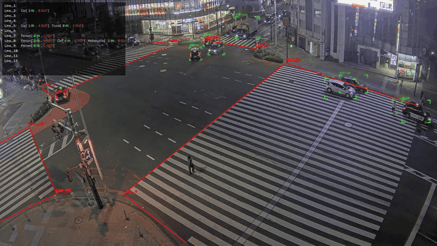

# Directional Line Crossing Counter

Count people and vehicles crossing user-drawn lines in a video, separated by direction (IN / OUT).

You draw one or more counting lines on the first frame of a video. Each frame is
then processed with an Ultralytics YOLO detector and the BoT-SORT tracker. A
track is counted when the bottom-center point of its box crosses a line segment.
The annotated video is written to disk frame by frame. A Tkinter launcher and a
command-line interface are both included.


<!-- add a short demo GIF here -->

## Features

- Interactive line drawing on the first frame in a resizable OpenCV window; clicks are mapped back to the original resolution.
- Any number of counting lines; lines can be saved to and loaded from JSON.
- Tracks the COCO classes person, car, motorcycle, bus and truck (configurable).
- Strict segment-to-segment crossing test: objects passing beside the end of a line are not counted.
- Direction (IN / OUT) from the sign of a 2D cross product; each track ID counted at most once per line.
- Per-line, per-class IN/OUT counts in a translucent on-frame HUD.
- Frames are written as they are processed, so a run stopped early still leaves a playable video.
- Optional, best-effort face blurring inside person boxes.
- Tkinter launcher (3-step flow) or headless CLI (`--lines` + `--no-display`).

## How it works

```
frame -> YOLO detect -> BoT-SORT track -> [face blur] -> bottom-center anchor
      -> segment prev->curr vs each line (CCW test) -> side sign -> IN / OUT
      -> draw boxes + lines + HUD -> write <name>_proc.mp4
```

- **Crossing:** the trajectory segment from the previous to the current anchor must intersect the drawn segment (counter-clockwise orientation test).
- **Direction:** IN when the anchor moves from the negative to the positive side of the directed line `P1 -> P2` (2D cross product); every other crossing is OUT. The click order of a line therefore defines which way is IN.
- **Deduplication:** each line remembers the track IDs it has already counted.

See [docs/how-it-works.md](docs/how-it-works.md) for the formulas, edge cases and tuning tips.

## Installation

Requires Python 3.9+ and a desktop session for the OpenCV/Tkinter windows.

```bash
python -m venv venv
# Windows
venv\Scripts\activate
# Linux / macOS
source venv/bin/activate

pip install -r requirements.txt
pip install -e .        # optional: installs the `line-counter` command
```

On Debian/Ubuntu, Tkinter and OpenCV GUI support may need system packages:
`sudo apt install python3-tk libgl1 libglib2.0-0`.

**GPU:** Ultralytics runs on CPU, but processing with the default `--imgsz 2048`
is slow without a GPU. For an NVIDIA GPU, install a CUDA build of PyTorch first
following the instructions on pytorch.org, then install the requirements.

Place the model weights in `weights/` (see [weights/README.md](weights/README.md)).

## Results

Example outputs produced by this project (re-encoded to H.264, max 1920 px wide, no audio):

| File | Content |
|---|---|
| [`results/shinjuku_line_count.mp4`](results/shinjuku_line_count.mp4) | Busy intersection with several counting lines; per-line IN/OUT counts for people and vehicles in the HUD. |

Source footage and attribution: see [results/README.md](results/README.md).

## Usage

GUI launcher (also opens when no `--input` is given):

```bash
line-counter            # or: python -m line_counter --gui
```

1. **Select Input Video** (`.mp4`, `.avi`, `.mov`, `.mkv`).
2. **Draw Lines on Frame**: left-click two points per line; press ENTER or ESC to finish.
3. **Process and Save Video**: choose an output folder. Press **Q** in the preview window to stop early.

CLI:

```bash
# Draw lines interactively, save them, then process
line-counter --input video.mp4 --save-lines lines.json

# Reuse saved lines, no preview window (stop with Ctrl+C)
line-counter --input video.mp4 --lines lines.json --no-display --output outputs/video_proc.mp4

# Stricter detection, smaller inference size, people only, with face blurring
line-counter --input video.mp4 --lines lines.json --conf 0.25 --imgsz 1280 --classes 0 --blur-faces
```

Lines file format (pixel coordinates in the original video resolution):

```json
[
  {"name": "Line_1", "points": [[120, 400], [860, 410]]}
]
```

## Parameters

| Name | Default | Description |
|---|---|---|
| `--input`, `-i` | none | Input video. Without it, the GUI opens. |
| `--output`, `-o` | `<input folder>/<name>_proc.mp4` | Output video path. |
| `--lines` | none | JSON file with lines; skips interactive drawing. |
| `--save-lines` | none | Export interactively drawn lines to JSON. |
| `--model` | `weights/yolov8m.pt` | Detector weights. Official Ultralytics names auto-download. |
| `--conf` | `0.01` | Detection confidence threshold (see note below). |
| `--imgsz` | `2048` | Inference image size. |
| `--classes` | `0 2 3 5 7` | COCO class IDs (person, car, motorcycle, bus, truck). |
| `--tracker` | `botsort.yaml` | Ultralytics tracker config (`bytetrack.yaml` also works). |
| `--blur-faces` | off | Blur faces detected inside person boxes. |
| `--face-model` | `weights/face_yolov8m.pt` | Face detector weights for `--blur-faces`. |
| `--no-display` | off | Disable the live preview (requires `--lines`). |
| `--gui` | off | Open the Tkinter launcher. |
| `--verbose`, `-v` | off | Debug logging. |

Fixed internal values (in `ProcessingConfig`): face detector confidence `0.3`,
blur kernel `51x51`, blur sigma `30`.

> **Note on `--conf`:** the default `0.01` is kept from the original prototype.
> It is very permissive: it keeps weak detections (fewer lost tracks) but also
> produces false positives. Values in the range 0.1-0.25 are a more usual
> starting point.

## Output

- `<name>_proc.mp4` (MP4V codec, same resolution and frame rate as the input) with:
  - corner-style boxes labelled `#<track id> <class>` and the bottom-center anchor point,
  - the counting lines and their names,
  - a translucent HUD with one row per line, e.g. `Line_1: Person[3 IN, 1 OUT]  Car[0 IN, 2 OUT]` (only classes with at least one crossing are shown).
- Log messages for every counted crossing and a final per-line, per-class summary.
- Optionally, a JSON lines file (`--save-lines`).

## Project structure

```
directional-line-crossing-counter/
  README.md
  requirements.txt
  pyproject.toml
  docs/how-it-works.md
  weights/README.md
  src/line_counter/
    __init__.py
    __main__.py      # python -m line_counter
    cli.py           # argparse entry point (line-counter)
    gui.py           # Tkinter launcher
    config.py        # ProcessingConfig dataclass with defaults
    geometry.py      # ccw, segments_intersect, side_of_line (stdlib only)
    counter.py       # CountingLine, LineCounter (stdlib only)
    lines_io.py      # JSON load/save of lines (stdlib only)
    line_editor.py   # interactive OpenCV line drawing
    drawing.py       # corner boxes, lines, HUD
    privacy.py       # FaceBlurrer
    pipeline.py      # processing loop
  tests/
    test_geometry.py
    test_counter.py
```

Run the tests with `pytest` (they only need the standard library).

## Limitations

- Counts depend entirely on detection and tracking quality. ID switches after occlusions can cause double counts; missed detections near a line can cause missed counts.
- Each track ID is counted once per line: an object that crosses, returns and crosses again is counted only the first time.
- The class of a count is the class detected in the crossing frame; class flicker (e.g. car/truck) can move counts between classes.
- Anchors landing exactly on a line or its endpoint are resolved asymmetrically by the strict CCW test (see [docs](docs/how-it-works.md#edge-cases)).
- The HUD panel has a fixed width; many classes or long line names can overflow it.
- No perspective correction: lines are drawn in image space.
- Face blurring is optional and **best-effort**: faces the face detector misses, and faces outside detected person boxes, are not blurred. Do not rely on it as the only anonymisation measure; review the output before sharing it and follow the privacy rules that apply where the video was recorded.
- Processing at `imgsz 2048` is slow on CPU.

## Models & credits

- [Ultralytics YOLOv8](https://github.com/ultralytics/ultralytics) detector and the BoT-SORT / ByteTrack tracker integration, AGPL-3.0.
- `yolov8m.pt`: Ultralytics COCO-pretrained weights, AGPL-3.0.
- `face_yolov8m.pt`: third-party YOLOv8 face detector, used only with `--blur-faces`. Origin and license are still to be confirmed (see [weights/README.md](weights/README.md)).
- [OpenCV](https://opencv.org/) (Apache-2.0) for video I/O and drawing.

## License

AGPL-3.0, because the project depends on Ultralytics, which is licensed under
AGPL-3.0. See the `LICENSE` file.
