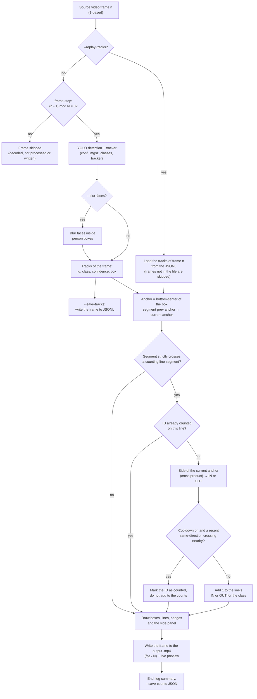

# How it works

This document explains the counting geometry, the processing pipeline and how
to tune the parameters.

## Pipeline

1. **Line definition.** The first frame is shown in a resizable OpenCV window.
   Each pair of left clicks creates a line (`Line_1`, `Line_2`, ...). Because
   the window can be resized or maximised, click coordinates are scaled back to
   the original video resolution:
   `x_orig = x_win * (W_orig / W_win)`, `y_orig = y_win * (H_orig / H_win)`.
   U or Backspace undoes the last point or line, and the canvas is redrawn when the
   window is resized. ENTER or ESC finishes. Lines can also be loaded from a JSON file
   (`--lines`) and exported (`--save-lines`).
2. **Detection and tracking.** Each frame goes through Ultralytics
   `model.track(..., persist=True, tracker="botsort.yaml")`, restricted to the
   COCO classes person (0), car (2), motorcycle (3), bus (5) and truck (7).
3. **Anchor point.** For every tracked box `(x1, y1, x2, y2)` the anchor is the
   bottom-center point `((x1 + x2) // 2, y2)`, roughly where feet or wheels
   touch the ground. The previous anchor of each track ID is stored, so every
   frame gives a short trajectory segment `C = prev -> D = curr`. The
   coordinates are integers: `x = (x1 + x2) // 2`.
4. **Counting.** Each segment is tested against each counting line (below).
5. **Output.** Annotated frames are written to disk immediately, so stopping
   early (Q in the preview window, closing it, or Ctrl+C) keeps every frame
   processed so far in a readable file.
6. **Frame step.** With `--frame-step N` only the frames 1, N+1, 2N+1, ... are
   processed and written, and the output fps is `fps / N`. The tracker and the
   crossing test only see these frames, so the trajectory step is N times
   longer (the segment test still works; very fast objects may switch IDs) and
   the tracker's `track_buffer` counts processed frames. `--cooldown-frames`
   is measured in source frames.
7. **Tracks and replay.** `--save-tracks` writes one JSON line per processed
   frame (`frame` = 1-based source index, plus id, class, confidence and box
   of every track). `--replay-tracks` skips the detector and the tracker, reads
   those lines and runs the same counting and drawing code, so the counts are
   identical to the original run (the frame step is inferred from the file).
   Face blurring is not applied in a replay. Classes that never appeared in the
   file are not pre-created, so their all-zero entries are missing from the
   replay's counts report.

## Directional line crossing (IN / OUT)

The logic uses 2D analytic geometry on the anchor points. Sections 1 to 4 describe the
original rule (`--min-cross-distance 0`); with the default `0.05` the crossing
hysteresis of section 7 is applied on top of it.

### 1. Strict segment intersection

Testing against an infinite line would count objects that pass beside the end
of the drawn line. Instead, the trajectory segment `CD` (previous to current
position) must physically intersect the drawn segment `AB`.

This uses the counter-clockwise (CCW) orientation test of three points:

$$\text{CCW}(A, B, C) = (C_y - A_y)(B_x - A_x) > (B_y - A_y)(C_x - A_x)$$

Two segments intersect if and only if the endpoints of the trajectory lie on
opposite sides of the drawn line **and** the endpoints of the drawn line lie
on opposite sides of the trajectory:

$$\text{Intersects} = \big(\text{CCW}(A, C, D) \neq \text{CCW}(B, C, D)\big) \land \big(\text{CCW}(A, B, C) \neq \text{CCW}(A, B, D)\big)$$

Implemented in `line_counter.geometry.ccw` and `segments_intersect`.

### 2. Side classification

Once a crossing is confirmed, the direction comes from the sign of the 2D
cross product (determinant) of the directed line `AB` and the point `P`:

$$\text{Side}(P) = (B_x - A_x)(P_y - A_y) - (B_y - A_y)(P_x - A_x)$$

In image coordinates (y grows downward):

- `Side(P) < 0`: `P` is on the left of `A -> B` as seen on screen.
- `Side(P) > 0`: `P` is on the right of `A -> B` as seen on screen.
- `Side(P) = 0`: `P` is on the line.

Implemented in `line_counter.geometry.side_of_line`.

### 3. Direction rules

- **IN**: the current anchor is on the positive side (`curr_side > 0`), i.e.
  the anchor came from the negative side (or from exactly on the line).
- **OUT**: the current anchor is not on the positive side (`curr_side <= 0`),
  i.e. the anchor left the positive side.

For a step that strictly crosses the line this is the same as "negative to
positive is IN, positive to negative is OUT".

So the meaning of IN/OUT depends on the order in which the two points of a
line were clicked. Example: for a horizontal line drawn left to right, an
object moving down the screen is IN and an object moving up is OUT. Draw the
line in the opposite order to swap the labels.

### 4. Deduplication

Each line keeps a set of track IDs already counted (`counted_ids`). A track is
counted at most once per line, whatever its class or direction later. The same
ID can still be counted once on each of several lines. Counts are stored per
line, per class name, per direction.

### 5. Cooldown (optional)

With `--cooldown-frames F` (> 0), a crossing is not added to the counts when
another one in the same direction was counted on the same line at most `F`
source frames earlier and within `--cooldown-px` pixels (distance between the
two current anchors). This absorbs ID switches that re-create the same
crossing. The suppressed ID is still marked as counted. Off by default because
two real people crossing side by side can also be merged.

### 6. Track gap (optional)

A tracker can drop an object and later give the same ID to something at a
different place. Normally the new position is compared with the last known one
however old it is, so that jump can look like a crossing. With
`--max-track-gap S` (seconds, > 0), if the previous position of a track is
more than `S` seconds (converted to source frames with the video fps) older than
the current frame, that step is not tested; the position is just refreshed.
Off by default, so counts do not change unless it is set.

It is a trade-off: it removes some false crossings caused by ID reuse, but it
also removes real crossings of a person who was lost for a while and found again
with the same ID. If you use it, set it at or above the tracker's buffer in
seconds (`track_buffer` x frame step / fps; for `botsort_reid_static.yaml` with
`track_buffer` 90 at `--frame-step 3` that is about 9 s), because the tracker
keeps lost IDs that long on purpose. A value like 2 s mostly cuts real
crossings.

Check on Shinjuku 90 s with `--max-track-gap 2` (one video, no ground truth):
23 of the removed crossings (all 13 on Line_8, 10 of 17 on Line_4) were judged
from still frames. 12 looked like real crossings of the same person briefly
lost, 4 were ID reuse, and 7 were unclear (4 of them small jitter of people
standing at the curb). The removed crossings had gaps of 2.4 to 9.1 s (median
5.5 s), and real and wrong cases overlapped fully in gap length and implied
speed (0.4 to 0.8 body heights per second), so no threshold separates them.

Known limitation: a person standing near a line can be counted after a long
loss because of a few pixels of box movement. No rule handles this.
### 7. Crossing hysteresis (optional, `--min-cross-distance`)

Without it (`--min-cross-distance 0`) a crossing is counted as soon as one step touches the line. A person
standing on a line has a bottom-centre anchor that jitters by a few pixels, so
it can step across the line by chance and be counted. With
`--min-cross-distance F` the counter keeps, per track and per line, the last
*confirmed* side: the side where the anchor was at least `F x box height` away
from the line, measured perpendicular to it. A crossing is counted when the
anchor is confirmed on the other side and the path touched the line segment in
between. While the anchor stays inside the band it decides nothing, so jitter
never counts, and a slow walker is counted on the first frame where the distance
is reached, however long that takes. A track first seen inside the band has no
confirmed side yet and cannot count until it has been confirmed on one side and
then on the other. A step after a `--max-track-gap` absence updates the side
but cannot count. With `F = 0` the original rule above is used unchanged.

### 8. Riders (optional, `--rider-overlap`)

A person on a scooter or bicycle is often detected twice: as a person and as a
motorcycle (or bicycle). With `--rider-overlap R` a person crossing is not counted when
the intersection of the person box with a bicycle or motorcycle box is at least
`R` of the person box in the frame of the crossing; the track is still marked as
counted. COCO class 1 (bicycle) is not in the default `--classes`; class 3
(motorcycle) is. In replay the vehicle class must be present in the tracks file.

### Edge cases

- The CCW test is strict, so a point exactly on the line is grouped with the
  negative side. With integer pixel anchors this is uncommon but possible:
  - negative -> on the line: not a crossing yet; the following step
    on the line -> positive is counted as IN;
  - positive -> on the line: counted as OUT immediately; the following step
    on the line -> negative is not a crossing.

  Either way the object is counted once, in the direction of its overall
  movement. A trajectory collinear with the line is never counted.
- Exactly at an endpoint of the line the strict test stays asymmetric: a step
  from the positive side that ends exactly on the endpoint is counted as OUT,
  while a step that leaves the endpoint toward the positive side is not
  counted. A trajectory that only grazes an endpoint is ambiguous anyway.
- If the tracker loses an object and gives it a new ID, the object can be
  counted again.
- A track that disappears and returns with the same ID is compared with its
  last known position, however old: if it reappears on the other side of a
  line it is counted.
- Lines of zero length never count; lines completely outside the frame never
  count either (a warning is logged). Lines file coordinates are rounded to
  whole pixels, line names must be unique and non-empty.
- The class used for a count is the class in the frame where the crossing
  happens; class flicker between frames can move a count to another class.

## Evaluation of the two filters

**Method.** Every crossing counted on the Abbey Road run (`results/abbey_road_3min_tracks.jsonl`,
`samples/abbey_road_lines.json`, no filters) was judged by hand from frame
sheets (a few frames around each crossing with the track box and trail): 105
counted, 79 true positives (TP), 19 false positives (FP) and 7 uncertain (U).
The same was done for Line_3 of the first 30 s of the Shinjuku 90 s run: 34
counted, 27 TP, 4 FP, 3 U. The filters were replayed from the saved tracks (no
detector ran), and each event was matched by line and track ID. This is one
reviewer, one pass, two videos, so the figures are an indication and not a
validation; a crossing that was never counted (a miss) is not measured. The main
causes of FP were people standing on the kerb line (about 13 of 19), ID swaps,
and a scooter rider counted as person and as motorcycle.

**`--min-cross-distance` on Abbey Road** (all four lines):

| Value | Counted | TP kept (of 79) | FP removed (of 19) | U kept (of 7) |
|---|---|---|---|---|
| 0 (off) | 105 | 79 | 0 | 7 |
| 0.02 | 101 | 79 | 3 | 6 |
| 0.03 | 99 | 79 | 5 | 6 |
| 0.05 | 98 | 79 | 6 | 6 |
| 0.075 | 95 | 78 | 8 | 6 |
| 0.1 | 91 | 76 | 9 | 5 |
| 0.15 | 87 | 74 | 11 | 5 |
| 0.2 | 87 | 74 | 11 | 5 |
| 0.3 | 79 | 70 | 14 | 4 |

No value counted a crossing that the unfiltered run did not count. Most FP that
remain are people who walk up to the line and stop on it (the anchor drifts
slowly through the band, which looks like a slow crossing), ID swaps and the
scooter duplicate; distance alone cannot tell those from real crossings.

**On Shinjuku** (Line_3, first 30 s, 34 counted): values 0.02 to 0.2 kept all 34,
so no FP was removed and nothing was lost. At 0.3 three counts disappeared (tracks
543, 684 and 2281); in the frame sheets all three walk clearly through the line,
so they look like TP lost (a re-check of those three events, not the original
per-event verdicts). Over the whole videos, without verdicts, the filter removes
about 6 to 7 percent of the counted crossings at 0.05 and 14 to 20 percent at 0.2
(Shinjuku 90 s: 366 -> 344 at 0.05, 334 at 0.1, 314 at 0.2).

**Decision.** No value removed most of the FP, so this is a conservative choice:
0.05 is the largest value that kept every verified TP (79 of 79 on Abbey Road, all
34 counted on Shinjuku Line_3 in the first 30 s) and it removes 6 of 19 FP; beyond
that real crossings are lost. It is therefore the default, and `--min-cross-distance 0`
restores the original rule. **The counts of the three shipped runs changed in this
version** because of this default (the tracks are the same, only the counting rule
differs); the before and after tables are in [results/README.md](../results/README.md).
The removed crossings outside the audited parts were not judged by hand.

**`--rider-overlap` on Abbey Road** (default classes, so motorcycles are the only
two-wheelers tracked; bicycles are not):

| Value | Counted | Counts removed |
|---|---|---|
| 0 (off) | 105 | none |
| 0.2 and 0.3 | 103 | person #943 (a scooter rider also counted as motorcycle #950) and person #1194 (an ID swap, not a rider) |
| 0.5 and 0.7 | 104 | person #943 only |
| 0.9 | 105 | none |

Only the scooter case where both boxes exist in the crossing frame is touched:
rider and scooter were two counts of one road user, and 0.5 leaves the
motorcycle count only. The other scooter cases (a rider counted as person with
no motorcycle box in that frame, and a label flipping between motorcycle and
person) are not affected. On both Shinjuku runs 0.3 and 0.5 changed nothing. One
event is too little to choose a default from, so it stays `0` (off); 0.5 is the
suggested value when riders are counted twice.

**Two more checks (visual judgement, no external ground truth).**

- *Recall on Abbey Road.* A second, independent reviewer went through every 0.5 s
  sheet and crops of the lines for crossings that were never counted: 2 likely
  missed crossings (Line_2, two pairs walking side by side where only one person
  got a box) and up to 3 uncertain ones in dense groups (Lines 1 and 2); none on
  Lines 3 and 4. With the 79 verified TP this gives a recall of about 94 to 97.5
  percent. The same reviewer judged two of the first reviewer's TP as FP (Line_2
  at 103.2 s, id 547: a walker took the box of a standing man; Line_3 at
  127.2 s, ids 943 and 950: one moped counted as person and as motorcycle), so
  the precision of the unfiltered 105 counts is a range: 77 to 79 TP, that is
  about 73 percent (uncertain counted as wrong) to 82 percent (uncertain
  counted as right).
- *What the 0.05 default removed on Shinjuku 3 min.* All 12 removed crossings on
  Line_7 and a random 10 of the 11 removed on each of Line_4 and Line_11 were
  judged by eye (32 events): 21 were false counts (people standing on the line
  with 1 to 4 px of jitter, tracks that start on the line, walkers sliding
  along it, stale anchors after an ID jump), 4 were real crossings that were
  lost (tracks born inside the band, or ending just short of it) and 7 could not
  be decided. Line_7 is short and far away (people about 33 px tall, so the band
  is only about 1.7 px). Lower values (0.03, 0.02) bring back 7 to 12 false counts
  to recover 3 real ones, and a fixed pixel floor instead of a fraction of the
  box height was worse, so 0.05 stays.

**Uncertain cases** on Abbey Road (seven): the person #119 walking from the road
onto the pavement on Line_1; on Line_2 the person #465 who stands at the kerb and
steps down and back, and #817, #1100, #1087 and #1144 (people at the kerb who
start moving slowly or walk along it); on Line_3 the person #547 who walks to the
end of the line and stops on it. The three uncertain cases of Shinjuku are not listed
individually.

## Optional face blurring

With `--blur-faces`, every detected person box (with or without a track ID)
is cropped and passed to a separate YOLO face detector (confidence 0.3); the
crops of one frame are sent to the face model in batches of up to 16. Each detected face box is grown by `--blur-padding` (default 15 % of its
width and height on each side, clipped to the person box) because detector
boxes are often tight, and the region is replaced by a
Gaussian blur (kernel 51x51, sigma 30). Blurring happens before boxes and text
are drawn. This is best-effort: faces the detector misses are not blurred, and
faces outside detected person boxes are never searched.

## Parameter guide and tuning tips

| Parameter | Default | Notes |
|---|---|---|
| `--conf` | `0.01` | Very permissive; keeps weak detections so the tracker rarely loses objects, but adds false positives. Values around 0.1-0.25 are a common starting point. |
| `--imgsz` | `2048` | Large inference size helps small/distant objects; slower and needs more GPU memory. Try 1280 or 640 on CPU or for close-up scenes. |
| `--model` | `weights/yolov8m.pt` | Smaller models (`yolov8n.pt`, `yolov8s.pt`) are faster, larger ones (`yolov8l.pt`, `yolov8x.pt`) may detect more. |
| `--tracker` | `botsort.yaml` | `bytetrack.yaml` is a lighter alternative. Custom YAML files can tune track buffer and matching thresholds. |
| `--classes` | `0 2 3 5 7` | Any COCO class IDs supported by the model. |
| `--min-cross-distance` | `0.05` | Fraction of the box height; 0 restores the original rule, larger values remove more jitter but also real crossings (see the evaluation above). |
| `--rider-overlap` | `0` | Fraction of the person box; 0.5 is a starting point when riders are counted twice. Needs class 1 or 3 in `--classes`. |

Tips:

- Place lines where objects are fully visible and move across the line, not
  along it. Avoid lines near the frame border, where boxes are clipped.
- Because the anchor is the bottom-center of the box, draw lines on the ground
  plane (floor, road) rather than at head height.
- Make lines long enough to cover the whole passage; trajectories that pass
  beside a segment end are intentionally not counted.
- Low frame rates produce long trajectory steps; the segment test still works,
  but the tracker is more likely to switch IDs.
