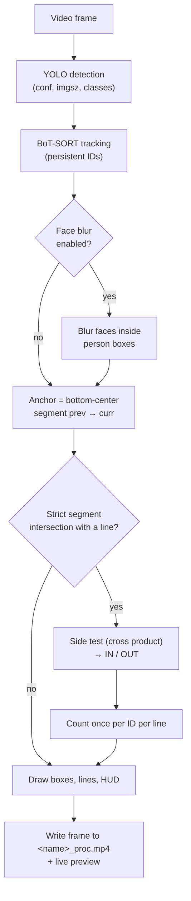

# How it works

This document explains the counting geometry, the processing pipeline and how
to tune the parameters.

## Pipeline

1. **Line definition.** The first frame is shown in a resizable OpenCV window.
   Each pair of left clicks creates a line (`Line_1`, `Line_2`, ...). Because
   the window can be resized or maximised, click coordinates are scaled back to
   the original video resolution:
   `x_orig = x_win * (W_orig / W_win)`, `y_orig = y_win * (H_orig / H_win)`.
   ENTER or ESC finishes. Lines can also be loaded from a JSON file
   (`--lines`) and exported (`--save-lines`).
2. **Detection and tracking.** Each frame goes through Ultralytics
   `model.track(..., persist=True, tracker="botsort.yaml")`, restricted to the
   COCO classes person (0), car (2), motorcycle (3), bus (5) and truck (7).
3. **Anchor point.** For every tracked box `(x1, y1, x2, y2)` the anchor is the
   bottom-center point `((x1 + x2) / 2, y2)`, roughly where feet or wheels
   touch the ground. The previous anchor of each track ID is stored, so every
   frame gives a short trajectory segment `C = prev -> D = curr`.
4. **Counting.** Each segment is tested against each counting line (below).
5. **Output.** Annotated frames are written to disk immediately, so stopping
   early (Q in the preview window, or Ctrl+C) keeps every frame processed so
   far in a readable file.

## Directional line crossing (IN / OUT)

The logic uses 2D analytic geometry on the anchor points.

### 1. Strict segment intersection

Testing against an infinite line would count objects that pass beside the end
of the drawn line. Instead, the trajectory segment `CD` (previous to current
position) must physically intersect the drawn segment `AB`.

This uses the counter-clockwise (CCW) orientation test of three points:

$$\text{CCW}(A, B, C) = (C_y - A_y)(B_x - A_x) > (B_y - A_y)(C_x - A_x)$$

Two segments intersect if and only if the endpoints of the trajectory lie on
opposite sides of the drawn line **and** the endpoints of the drawn line lie
on opposite sides of the trajectory:

$$\text{Intersects} = \big(\text{CCW}(A, C, D) \neq \text{CCW}(B, C, D)\big) \land \big(\text{CCW}(A, B, C) \neq \text{CCW}(A, B, D)\big)$$

Implemented in `line_counter.geometry.ccw` and `segments_intersect`.

### 2. Side classification

Once a crossing is confirmed, the direction comes from the sign of the 2D
cross product (determinant) of the directed line `AB` and the point `P`:

$$\text{Side}(P) = (B_x - A_x)(P_y - A_y) - (B_y - A_y)(P_x - A_x)$$

In image coordinates (y grows downward):

- `Side(P) < 0`: `P` is on the left of `A -> B` as seen on screen.
- `Side(P) > 0`: `P` is on the right of `A -> B` as seen on screen.
- `Side(P) = 0`: `P` is on the line.

Implemented in `line_counter.geometry.side_of_line`.

### 3. Direction rules

- **IN**: the current anchor is on the positive side (`curr_side > 0`), i.e.
  the anchor came from the negative side (or from exactly on the line).
- **OUT**: the current anchor is not on the positive side (`curr_side <= 0`),
  i.e. the anchor left the positive side.

For a step that strictly crosses the line this is the same as "negative to
positive is IN, positive to negative is OUT".

So the meaning of IN/OUT depends on the order in which the two points of a
line were clicked. Example: for a horizontal line drawn left to right, an
object moving down the screen is IN and an object moving up is OUT. Draw the
line in the opposite order to swap the labels.

### 4. Deduplication

Each line keeps a set of track IDs already counted (`counted_ids`). A track is
counted at most once per line, whatever its class or direction later. The same
ID can still be counted once on each of several lines. Counts are stored per
line, per class name, per direction.

### Edge cases

- The CCW test is strict, so a point exactly on the line is grouped with the
  negative side. With integer pixel anchors this is uncommon but possible:
  - negative -> on the line: not a crossing yet; the following step
    on the line -> positive is counted as IN;
  - positive -> on the line: counted as OUT immediately; the following step
    on the line -> negative is not a crossing.

  Either way the object is counted once, in the direction of its overall
  movement. A trajectory collinear with the line is never counted.
- Exactly at an endpoint of the line the strict test stays asymmetric: a step
  from the positive side that ends exactly on the endpoint is counted as OUT,
  while a step that leaves the endpoint toward the positive side is not
  counted. A trajectory that only grazes an endpoint is ambiguous anyway.
- If the tracker loses an object and gives it a new ID, the object can be
  counted again.
- The class used for a count is the class in the frame where the crossing
  happens; class flicker between frames can move a count to another class.

## Optional face blurring

With `--blur-faces`, every detected person box (with or without a track ID)
is cropped and passed to a separate YOLO face detector (confidence 0.3); the
crops of one frame are sent to the face model in batches of up to 16. Each detected face region is replaced by a
Gaussian blur (kernel 51x51, sigma 30). Blurring happens before boxes and text
are drawn. This is best-effort: faces the detector misses are not blurred, and
faces outside detected person boxes are never searched.

## Parameter guide and tuning tips

| Parameter | Default | Notes |
|---|---|---|
| `--conf` | `0.01` | Very permissive; keeps weak detections so the tracker rarely loses objects, but adds false positives. Values around 0.1-0.25 are a common starting point. |
| `--imgsz` | `2048` | Large inference size helps small/distant objects; slower and needs more GPU memory. Try 1280 or 640 on CPU or for close-up scenes. |
| `--model` | `weights/yolov8m.pt` | Smaller models (`yolov8n.pt`, `yolov8s.pt`) are faster, larger ones (`yolov8l.pt`, `yolov8x.pt`) may detect more. |
| `--tracker` | `botsort.yaml` | `bytetrack.yaml` is a lighter alternative. Custom YAML files can tune track buffer and matching thresholds. |
| `--classes` | `0 2 3 5 7` | Any COCO class IDs supported by the model. |

Tips:

- Place lines where objects are fully visible and move across the line, not
  along it. Avoid lines near the frame border, where boxes are clipped.
- Because the anchor is the bottom-center of the box, draw lines on the ground
  plane (floor, road) rather than at head height.
- Make lines long enough to cover the whole passage; trajectories that pass
  beside a segment end are intentionally not counted.
- Low frame rates produce long trajectory steps; the segment test still works,
  but the tracker is more likely to switch IDs.
